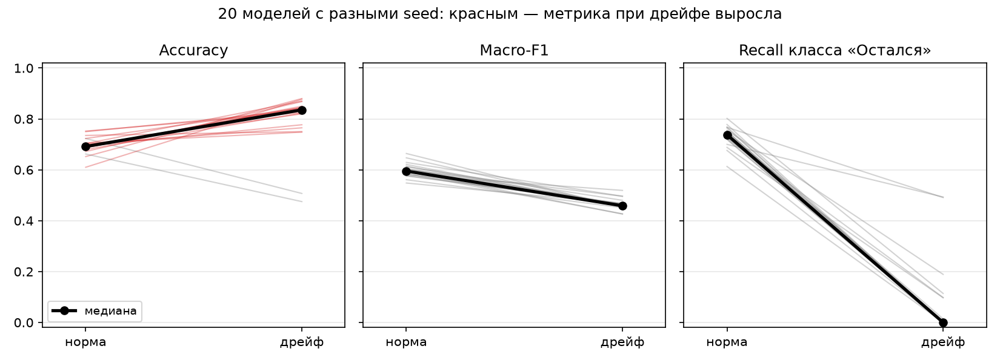
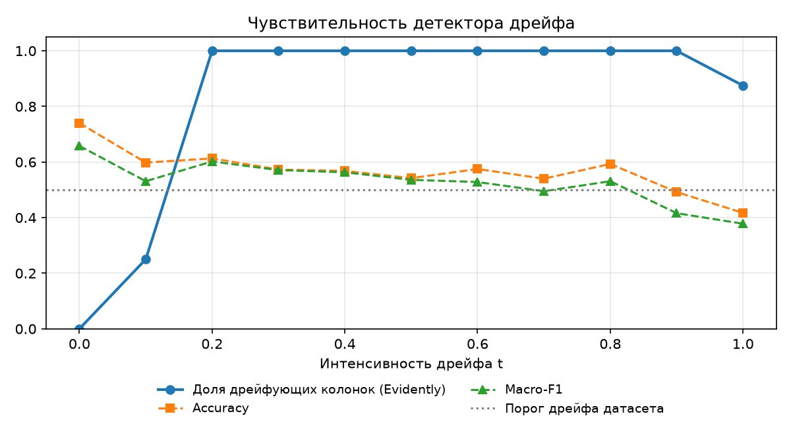

# Churn model monitoring: дрейф данных и деградация модели

Модель оттока клиентов, REST API, который её обслуживает, и система мониторинга на [Evidently AI](https://docs.evidentlyai.com), которая замечает, что поток данных «уехал» от обучающей выборки.

Проект вырос из курсовой работы «Применение средств машинного обучения для интеллектуального анализа данных» (РГУ нефти и газа им. Губкина, 2026).

**Главный вывод:** при сильном дрейфе Accuracy модели обычно **растёт** — в 18 из 20 запусков, медиана 0.69 → 0.84, — хотя модель сломалась: она предсказывает отток всем подряд, и recall класса «Остался» падает с 0.74 до 0.00. Macro-F1 при этом падает во всех 20 запусках. Одна агрегированная метрика деградацию скрывает; метрики по классам и детектор дрейфа её показывают.



## Что внутри

```
train ──► artifacts/model.joblib + reference_data.csv (эталон)
                 │
                 ▼
FastAPI  /predict ──► SQLite (лог запросов) ──► /export (CSV)
                                                    │
                                                    ▼
              monitor: Evidently DataDrift + Classification ──► HTML-отчёты, summary.json,
                                                                код возврата 1 при дрейфе
```

| Компонент | Файл | Что делает |
|---|---|---|
| Данные | `src/churn_monitoring/data.py` | Генератор клиентов с параметром интенсивности дрейфа `drift ∈ [0, 1]` |
| Обучение | `src/churn_monitoring/train.py` | RandomForest + StandardScaler в одном пайплайне, сохраняет эталонную выборку |
| API | `src/churn_monitoring/api.py` | FastAPI: `/predict`, `/logs`, `/stats`, `/export`, `/health`; каждый запрос пишется в SQLite |
| Мониторинг | `src/churn_monitoring/monitor.py` | Отчёты Evidently, метрики по классам, анализ чувствительности |
| Инфраструктура | `Dockerfile`, `docker-compose.yml`, `.github/workflows/ci.yml` | Контейнер с healthcheck, CI: линтер, тесты, отчёты, сборка и smoke-тест образа |

## Результаты

Все цифры ниже воспроизводятся командой `python -m churn_monitoring.monitor experiment`; полный вывод — в [`reports/summary.json`](reports/summary.json).

**Модель.** RandomForest (100 деревьев, глубина 5, `class_weight="balanced"`) на 800 клиентах, отток ≈ 21%. На отложенных 200: Accuracy 0.77, F1 класса «Ушёл» 0.56, macro-F1 0.70.

**Детектор дрейфа** (Evidently, 400 новых клиентов, 8 колонок: 6 признаков, target и prediction):

| | Нормальные данные | Сильный дрейф |
|---|---|---|
| Дрейфующих колонок | 0 из 8 (все p-value ≥ 0.14) | 7 из 8 (p-value ≈ 0) |
| Дрейф датасета (> 50% колонок) | нет | **да** |
| Реальный отток | 21% | 87% |

**Чувствительность.** Интенсивность дрейфа `t` плавно меняется от 0 до 1. При `t = 0.1` сдвигаются 25% колонок, а уже с `t = 0.2` срабатывает дрейф всего датасета. Значит, детектор ловит и умеренный сдвиг, а не только крайний случай.



**Устойчивость вывода.** Один запуск может оказаться случайностью, поэтому эксперимент повторён для 20 моделей с разными seed ([`reports/seed_study.csv`](reports/seed_study.csv)). Ниже медианы:

| Метрика | Норма | Дрейф |
|---|---|---|
| Accuracy | 0.69 | **0.84** ↑ |
| Macro-F1 | 0.60 | 0.46 ↓ |
| Recall «Остался» | 0.74 | **0.00** |
| Доля предсказанного оттока | 31% | 100% |

Почему так: при дрейфе почти все клиенты становятся «уходящими» (87%), и выродившаяся модель, которая всем ставит «уйдёт», формально угадывает чаще. Модель из основного запуска (seed 42) — одно из двух исключений: она не выродилась, поэтому её Accuracy при дрейфе упала (0.71 → 0.39), а колонка `prediction` не сдвинулась. Это тоже аргумент в пользу мониторинга входных данных: по выходу модели проблему видно не всегда.

## Запуск

### Локально

```bash
python -m venv .venv
source .venv/bin/activate          # Windows: .venv\Scripts\activate
pip install -r requirements.txt
pip install -e .

python -m churn_monitoring.train                 # обучить модель
python -m churn_monitoring.monitor experiment    # эксперимент, отчёты в reports/
uvicorn churn_monitoring.api:app --reload        # API на http://localhost:8000/docs
```

Проверить реальный поток запросов к API на дрейф:

```bash
curl -s localhost:8000/export > current.csv
python -m churn_monitoring.monitor check current.csv   # код возврата 1 = дрейф
```

### В Docker

```bash
docker compose up --build api                    # API на http://localhost:8000/docs
docker compose run --rm monitor                  # эксперимент, отчёты в ./reports
```

### Тесты

```bash
pip install pytest httpx
pytest -q
```

## Данные

Синтетический набор из 1000 клиентов банка, 6 признаков. Отток задан бизнес-логикой: неактивные клиенты с низким балансом и одним продуктом уходят чаще.

| Признак | Описание | Норма | Максимальный дрейф |
|---|---|---|---|
| `age` | возраст, лет | 18–70 | 50–80 |
| `tenure` | срок обслуживания, мес. | 1–60 | 1–20 |
| `balance` | баланс, руб. | 0–100 000 | 0–15 000 |
| `num_products` | число продуктов | 1–4 | 1 |
| `is_active` | активность | 50% активных | 0% активных |
| `salary` | доход, руб./мес. | 20 000–120 000 | 10 000–30 000 |

Дрейф моделирует и **covariate shift** (меняются распределения признаков), и **concept drift** (меняется сама зависимость: доля ухода тянется к 85%). Промежуточные состояния получаются линейной интерполяцией границ по параметру `t`.

## Что можно развить

- Автоматическое переобучение по триггеру: дрейф обнаружен и качество ниже порога.
- Мониторинг по расписанию (cron или GitHub Actions `schedule`) с уведомлением в Telegram.
- Хранение истории метрик в PostgreSQL и дашборд в Grafana.
